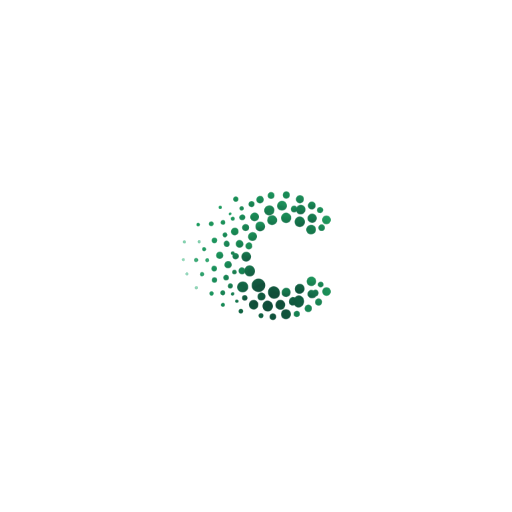
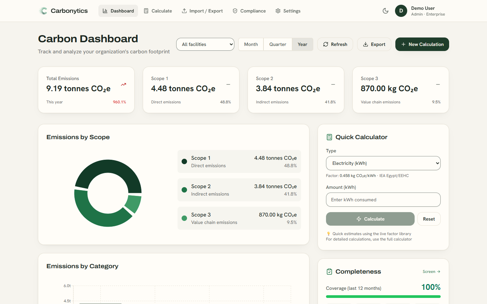
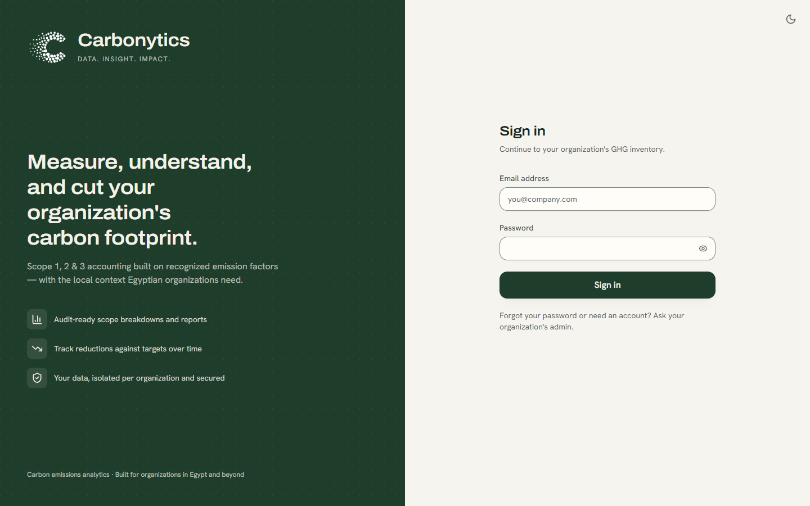
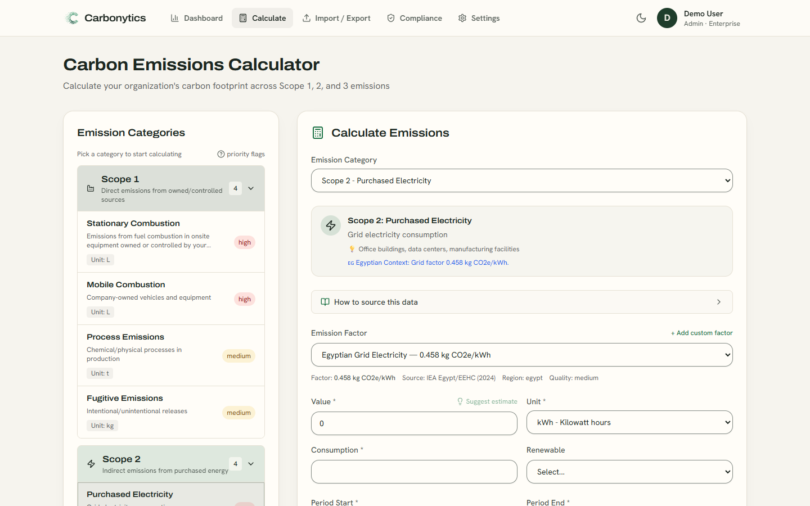
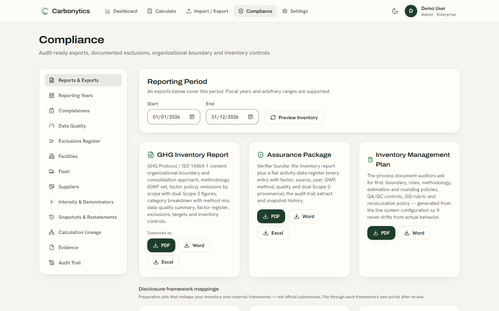
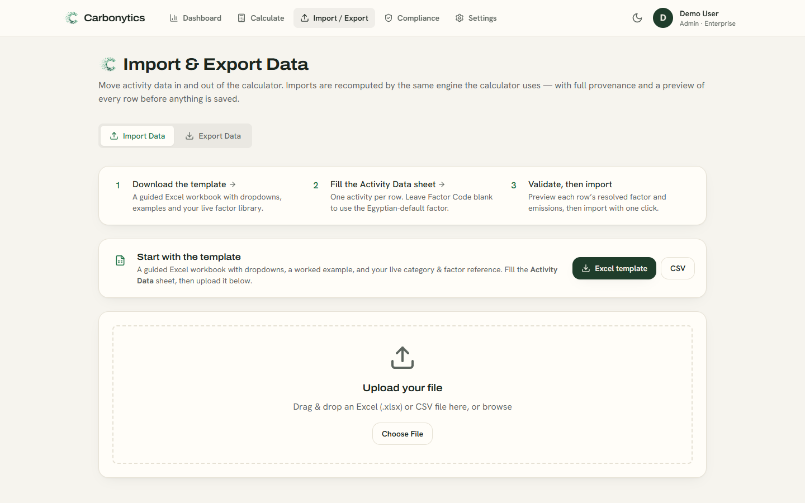
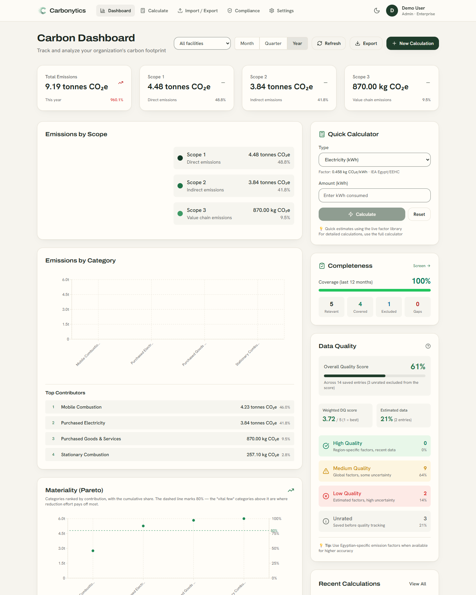
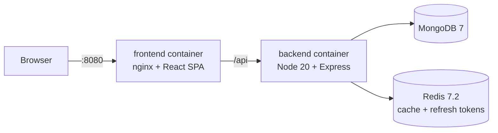

<div align="center">



# Carbonytics

**Greenhouse-gas accounting for organizations in Egypt and the wider MENA region.**

Measure Scope 1, 2, and 3 emissions with Egyptian emission factors as the default,<br>
trace every reported number back to its source, and export audit-ready reports.

[Quick start](#run-it-locally-with-docker) ·
[Screenshots](#a-look-around) ·
[Develop](#develop-with-hot-reload) ·
[Methodology](#methodology-rules-the-code-enforces) ·
[Deploy](#deploy)

</div>

<picture>
	<source media="(prefers-color-scheme: dark)" srcset="docs/images/dashboard-dark.png">
	
</picture>

## What Carbonytics does

Organizations in Egypt and the MENA region have few carbon-accounting tools that use local data and hold up in an audit. Carbonytics is a multi-tenant web app that fills that gap. It follows the GHG Protocol, picks Egyptian emission factors first, and keeps the trail from each report figure down to the calculation line, the factor version, the data-quality score, and the evidence file behind it.

It serves three kinds of users with the same calculation engine. The organization's **persona** setting changes how much of it they see:

- **Enterprise sustainability teams** who build audit-ready inventories and prepare CDP, SBTi, and ESRS disclosures.
- **Carbon consultants** who run inventories for client organizations and need defensible methodology and client-ready reports.
- **Small and medium businesses**, often export suppliers measuring their first footprint. SME mode trims the Compliance area to four tabs.

### Main capabilities

- A calculator for all three scopes, with the 15 Scope 3 categories, dual Scope 2 reporting (location-based and market-based), per-gas breakdowns, and biogenic CO₂ kept outside the scope totals.
- An emission-factor library with Egyptian, DEFRA 2024, EPA 2025, IPCC EFDB, and GHG Protocol sources, plus custom and supplier-specific factors. Each factor keeps a version history, so a locked calculation always points at the exact factor it used.
- Bulk entry through a guided Excel template or CSV. Every row is previewed and recalculated by the same engine as the calculator before anything is saved.
- An organization structure of entities, facilities, and a vehicle fleet, with consolidation by equity share, operational control, or financial control.
- Reporting years that move from Draft to Review to Published, with a base year, recalculation checks, snapshots, and restatements.
- Data-quality scoring (PCAF 1 to 5 and the GHG Protocol pedigree matrix), a completeness screen, an exclusions register, and an audit trail.
- Branded exports in PDF, Word, and Excel: a GHG inventory report, an assurance package for verifiers, an Inventory Management Plan, and mappings for CDP, SBTi, and ESRS E1.
- Five roles: admin, manager, user, verifier (read-only, can verify calculations), and viewer.

## A look around

<table>
	<tr>
		<td width="50%"></td>
		<td width="50%"></td>
	</tr>
	<tr>
		<td><b>Sign in.</b> Light and dark themes, and a layout ready for right-to-left languages.</td>
		<td><b>Calculate.</b> Pick a category and the Egyptian factor is preselected, with its source and quality shown.</td>
	</tr>
	<tr>
		<td></td>
		<td></td>
	</tr>
	<tr>
		<td><b>Report.</b> Thirteen compliance tabs, from reporting years to calculation lineage and evidence.</td>
		<td><b>Import.</b> Fill the Excel template, preview each resolved row, then import it.</td>
	</tr>
</table>

<details>
<summary>The full dashboard (category breakdown, Pareto chart, and data quality)</summary>



</details>

The images come from the demo organization. To regenerate them, start the app and run `node scripts/readme-screenshots.mjs` (it drives a headless Chrome or Edge).

## Run it locally with Docker

This path needs only Docker. It starts MongoDB, Redis, the API, and the web app, and puts them behind one nginx origin, the same way production runs.

### Before you start

- [Docker Desktop](https://docs.docker.com/get-docker/) on Windows or macOS, or Docker Engine with the Compose plugin on Linux.
- [Git](https://git-scm.com/downloads).
- Ports **8080** and **5000** free on your machine.

The commands below work the same in PowerShell, Command Prompt, Git Bash, macOS Terminal, and Linux shells.

### Start the stack

1. Clone the repository and go into it.

	```bash
	git clone https://github.com/MohShalaby92/Carbonytics.git
	cd Carbonytics
	```

2. Build and start the four services. The first build takes a few minutes.

	```bash
	docker compose up -d --build --wait
	```

	When it finishes, `docker compose ps` lists `mongo`, `redis`, `backend`, and `frontend`. The `mongo`, `redis`, and `backend` services show `healthy`.

3. Load the emission categories and starter factors.

	```bash
	docker compose exec backend node dist/scripts/seed.js
	```

	**Warning.** `seed.js` deletes every emission category and factor before it loads the starter set, including custom factors. Run it only on a new database.

4. Create the demo organization and its admin account.

	```bash
	docker compose exec backend node dist/scripts/createDemoUser.js
	```

5. Optional: load the industry benchmarks that the dashboard compares against.

	```bash
	docker compose exec backend node dist/scripts/seedBenchmarks.js
	```

6. Open <http://localhost:8080> and sign in with the demo account.

	| Email | Password |
	| --- | --- |
	| `demo@carbonytics.com` | `Demo!2026Pass` |

	The Vite dev server shows these credentials on the sign-in page. Production builds, including this Docker stack, hide them.

A new database starts with 24 starter factors. The full library of about 1,350 factors comes from the official datasheets through the import scripts in [`backend/src/scripts`](backend/src/scripts). [`docs/HANDOFF.md`](docs/HANDOFF.md) lists the import commands.

### Stop or reset

```bash
docker compose down        # stop, keep your data
docker compose down -v     # stop and delete the database and cache volumes
```

## Develop with hot reload

You need [Node.js 20](https://nodejs.org/) or later. Install the dependencies once from the repository root, which also installs the `frontend`, `backend`, and `shared` workspaces:

```bash
npm install
```

### Work on the web app

Keep the Docker stack running for the API, then start the Vite dev server:

```bash
npm run dev --prefix frontend
```

Open <http://localhost:3000>. Vite reloads the page when you save, and forwards `/api` requests to the API on port 5000.

### Work on the API

The API needs MongoDB on `localhost:27017` and Redis on `localhost:6379`. If you don't have them installed, run them in Docker:

```bash
docker run -d --name carbonytics-dev-mongo -p 27017:27017 mongo:7.0
docker run -d --name carbonytics-dev-redis -p 6379:6379 redis:7.2-alpine
```

Then start the API with `nodemon`. It restarts when you save a file:

```bash
npm run dev --prefix backend
```

Stop the Docker stack's `backend` container first, or set `PORT` to another value, because both use port 5000. Without a `.env` file the API uses development-only JWT secrets and prints a warning. To set your own values, copy [`.env.example`](.env.example) to `backend/.env`. Then change the host names `mongo` and `redis` in `MONGODB_URI` and `REDIS_URL` to `localhost`, because those names exist only inside the Docker network.

To run the API and the web app together, use `npm run dev` from the repository root.

### Check your work

| Command | What it runs |
| --- | --- |
| `npm test --prefix backend` | 137 Jest tests for the calculation engine, factor versioning, auth, imports, and reports. They need no database. |
| `npm run typecheck --prefix frontend` | The TypeScript compiler over the web app. |
| `npm test` | Both of the above, from the repository root. |

## Methodology rules the code enforces

These rules come from [`PRODUCT.md`](PRODUCT.md). Changes must not break them.

1. Egyptian emission factors are the default. A different factor is used only when someone chooses it.
2. No factor value is invented. CO₂-only sources are labelled CO₂-only, and CH₄ and N₂O are never filled in.
3. GWP is never applied twice. Per-gas factors use the organization's GWP set (AR4, AR5, or AR6). CO₂e factors are used as published.
4. Estimates stay visible: flagged, rated low quality, and never chained from other estimates. Gaps are never filled silently.
5. Locked calculations cannot change. A restatement goes through an audited unlock and re-lock, and a published reporting year accepts no new data.
6. Consolidation is a reporting view. Stored emissions stay at 100% gross.

The first rule lives in `findBestEmissionFactor` in [`calculationEngine.ts`](backend/src/services/calculationEngine.ts). It searches Egyptian shared factors first, then the organization's custom factors, then global and other regions. Inside each tier it takes the factor closest to the activity year, and it skips a factor from a later year when an earlier one exists:

```ts
const pickBestVintage = (factors: any[]) => {
	if (factors.length === 0) return null;
	const notAfter = factors.filter((f) => (f.year ?? 0) <= activityYear);
	const pool = notAfter.length > 0 ? notAfter : factors;
	pool.sort((a, b) => {
		const da = Math.abs(activityYear - (a.year ?? 0));
		const db = Math.abs(activityYear - (b.year ?? 0));
		if (da !== db) return da - db;
		return (b.isDefault ? 1 : 0) - (a.isDefault ? 1 : 0);
	});
	return pool[0];
};
```

## How the pieces fit



The browser talks to one origin. nginx serves the single-page app and forwards `/api` to the Express API, so the httpOnly refresh cookie works without cross-site rules. The API keeps a short-lived access token in memory and rotates the refresh token through Redis.

| Layer | Main tools |
| --- | --- |
| Web app | React 19, TypeScript, Vite 5, Tailwind CSS 3, Recharts 3 |
| API | Node.js 20, Express 4, TypeScript, Mongoose 8, Jest |
| Data | MongoDB 7, Redis 7.2 |
| Reports | PDF, Word, and Excel generators in `backend/src/services` |
| Operations | Docker Compose, nginx, Let's Encrypt, Prometheus, Grafana |

### Where things live

```text
Carbonytics/
├── backend/            Express API: models, routes, controllers, services, scripts
│   ├── src/scripts/    Seeding, factor imports, and data migrations
│   └── tests/          Jest tests
├── frontend/           React app: pages, components, hooks, services
│   └── DESIGN.md       Design system: colors, type, components
├── shared/             Types shared by the web app and the API
├── docs/               Hand-off notes, deployment guides, screenshots
├── scripts/            Backup, deploy, seed, and screenshot scripts
├── nginx/              Production reverse-proxy configuration
├── monitoring/         Prometheus and Grafana configuration
├── docker-compose.yml          Local stack (this README)
├── docker-compose.prod.yml     Hardened production stack
└── docker-compose.review.yml   Invite-only review stack
```

## Configuration

The local stack sets its own values in [`docker-compose.yml`](docker-compose.yml), so you don't need a `.env` file to try it. For other setups, copy [`.env.example`](.env.example) and change these first:

| Variable | Purpose |
| --- | --- |
| `MONGODB_URI`, `REDIS_URL` | Database and cache connections. |
| `JWT_SECRET`, `JWT_REFRESH_SECRET` | Two different random values of at least 32 characters. In production the API refuses to start if either is missing or weak. Generate one with `openssl rand -base64 48`. |
| `COOKIE_SECURE` | `true` when the app is served over HTTPS. |
| `CLIENT_URL` | The address people use to open the app. |
| `RATE_LIMIT_MAX`, `AUTH_RATE_LIMIT_MAX` | Requests allowed per 15 minutes per IP address, overall and for sign-in. |

## Deploy

- [`docker-compose.prod.yml`](docker-compose.prod.yml) is the hardened stack: HTTPS through nginx, a least-privilege MongoDB user, Redis with a password, private metrics, and backups. Start from [`.env.production.example`](.env.production.example).
- [`docs/REVIEW_DEPLOY.md`](docs/REVIEW_DEPLOY.md) walks through the invite-only review instance on a small VM with a free DuckDNS name and Let's Encrypt certificates.

Never reuse the secrets from `docker-compose.yml` outside your own machine.

## Accessibility and language

- English is the only interface language today. Arabic is planned, and an `en` and `ar` organization setting exists. New UI uses logical CSS properties and translatable strings so it can switch to right-to-left without a rewrite.
- Form fields have visible labels, 3:1 contrast borders, and full-strength focus rings. Errors appear next to the field they belong to, and focus moves to the first problem.
- Light and dark themes follow your system setting, and you can switch them from the top bar.
- No formal accessibility standard has been adopted yet. Reports of barriers are welcome as GitHub issues.

## Status

Carbonytics started as the graduation project for the ALX Software Engineering program and has grown into a working enterprise build. It has no customers or pilots yet. An invite-only review by emission specialists is being set up.

Not built yet:

- Single sign-on and SCIM user provisioning.
- Switching between client organizations in one consultant workspace.
- Monte Carlo uncertainty analysis and removals reporting.
- Spend-based (EEIO) sector factors and an Egyptian grid transmission-loss rate. Both wait for official datasheets.

## Troubleshooting

**`port is already allocated` when the stack starts.** Another program uses port 8080 or 5000. Stop it, or change the left-hand number of the `ports` entries in `docker-compose.yml`.

**New factors or categories don't appear after an import.** The API caches them in Redis for up to an hour. Clear the cache:

```bash
docker compose exec redis redis-cli FLUSHALL
```

This also signs everyone out.

**A `docker compose exec` command with a `/tmp/...` path fails in Git Bash.** Git Bash rewrites paths that start with `/`. Run the command in PowerShell, or put `MSYS_NO_PATHCONV=1` in front of it.

**The first page load shows one failed `401` request.** That is the app checking for an existing session before you sign in. It is expected.

## Contributing

Issues and pull requests are welcome. Before you open a pull request:

1. Run `npm test` from the repository root.
2. Check that the change keeps the [methodology rules](#methodology-rules-the-code-enforces).
3. For UI changes, follow [`frontend/DESIGN.md`](frontend/DESIGN.md) and check both themes.

## Author

Built by Mohamed Shalaby ([@MohShalaby92](https://github.com/MohShalaby92), [LinkedIn](https://www.linkedin.com/in/mohamed-shalaby-500a251b7/)).

The repository has no license file yet, so the default copyright rules apply. Ask the author before you reuse the code.
